

  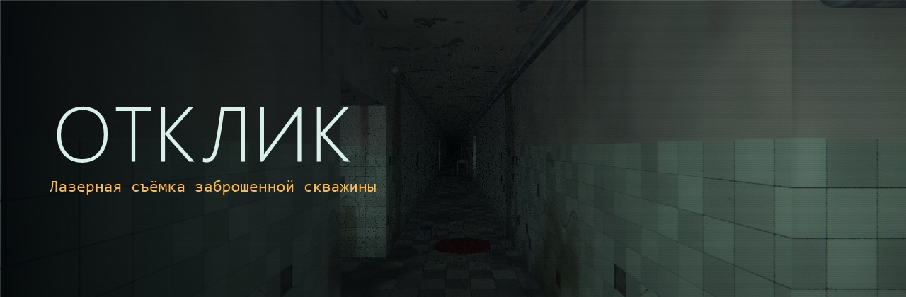

<h3 align="center">В темноте есть только то, что вы измерили.</h3>

  Хоррор от первого лица, в котором нет света. Мир существует только там, куда вы навели лазер.

  
  
  

---

## О чём игра

Таймыр, ноябрь 1989 года. Закрытый посёлок при сверхглубокой научной скважине.

Нина Ветрова просыпается оттого, что её дом замолчал. Нет ни лифта, ни батарей, ни соседского телевизора. Лампочки не загораются, фонарь садится за минуту. Брат Нины работает на скважине, и двенадцать дней от него нет вестей. Вчера от него пришла посылка без письма: рация и опытный лазерный дальномер «Луч-3».

Дальномер ничего не освещает. Он только измеряет.

Потом в квартире звонит телефон, хотя линию отключили ещё в сентябре. Голос в трубке говорит спускаться. Вниз по лестнице, через подвал, школу и больницу, мимо музея и дома культуры, по железной дороге к руднику и дальше, на три с лишним километра под землю.

Каждая точка на экране — вопрос, заданный темноте. Вопрос в том, кто отвечает.

## Как это выглядит

  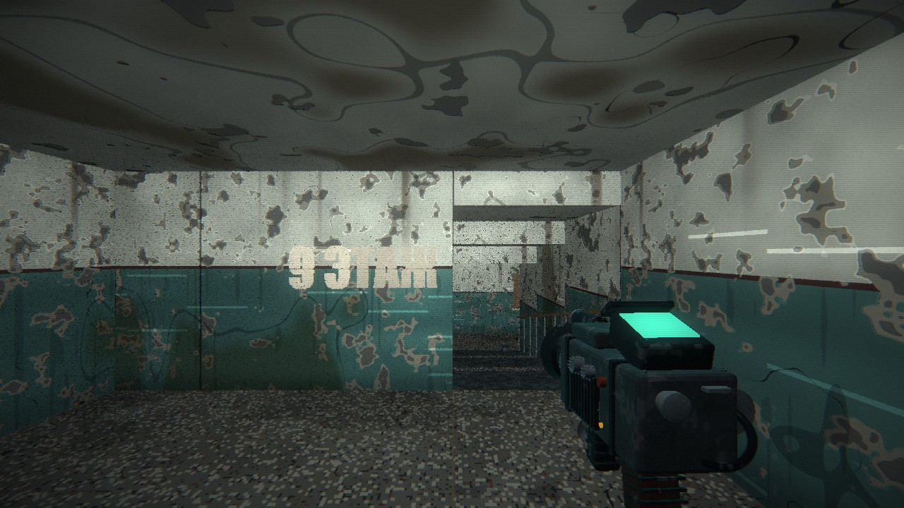
  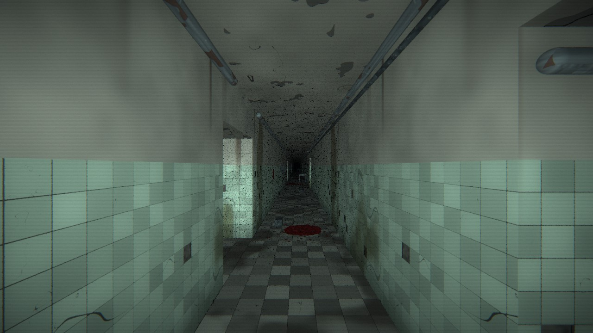

  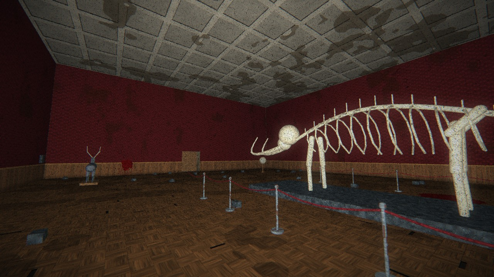
  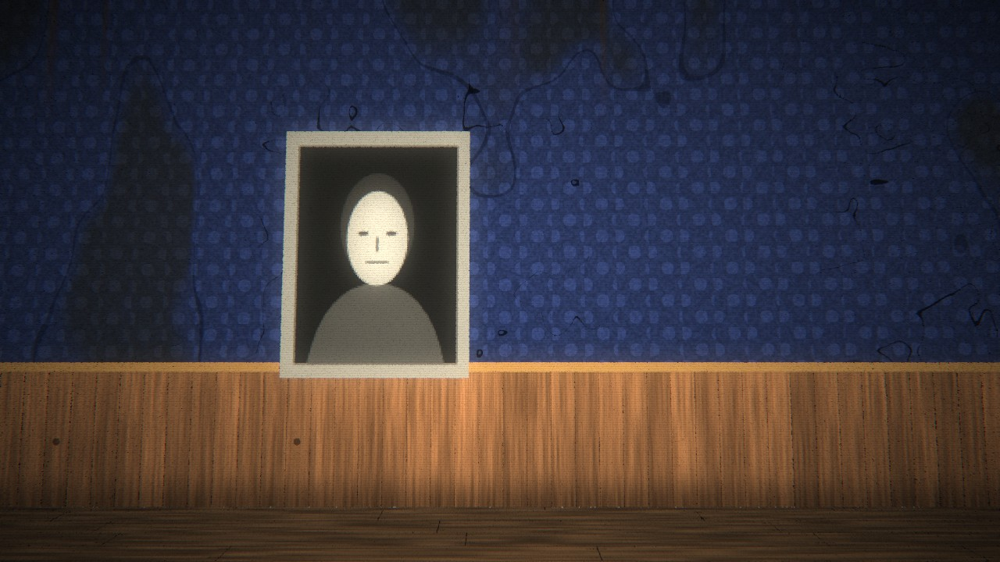

  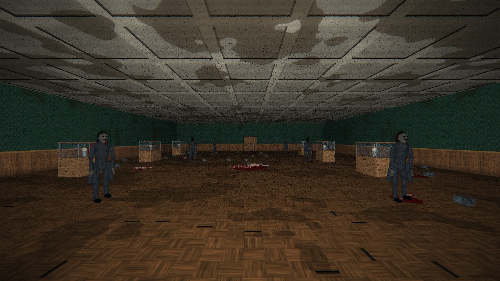
  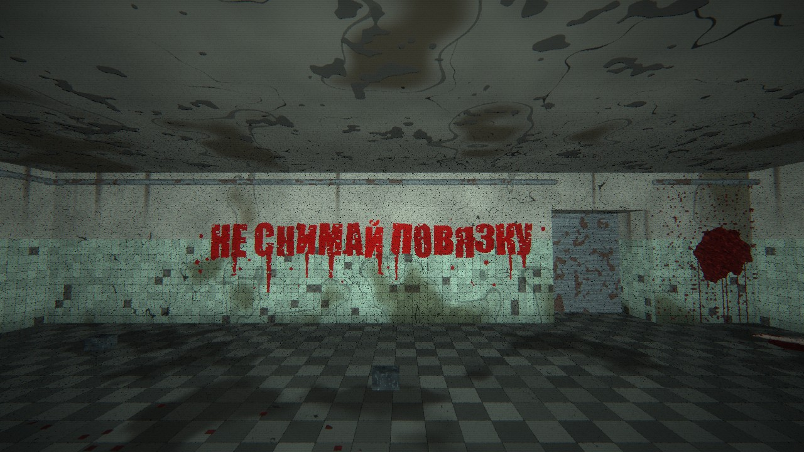

  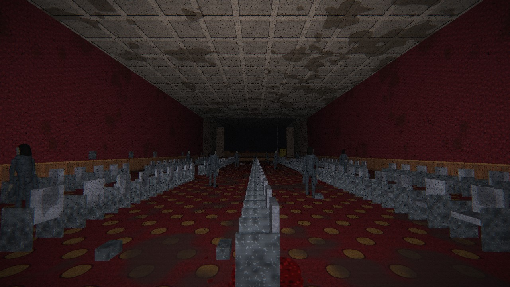
  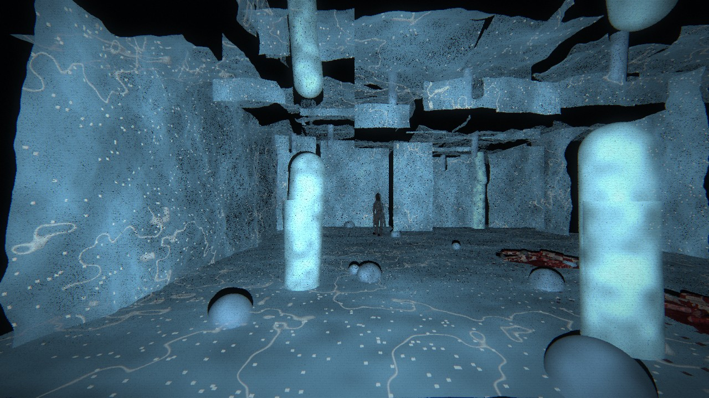

  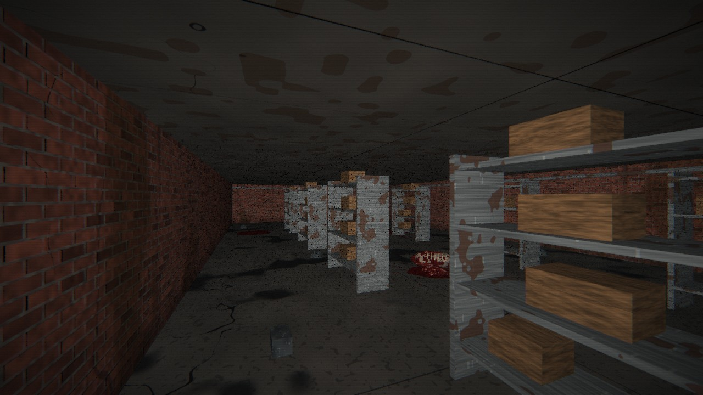
  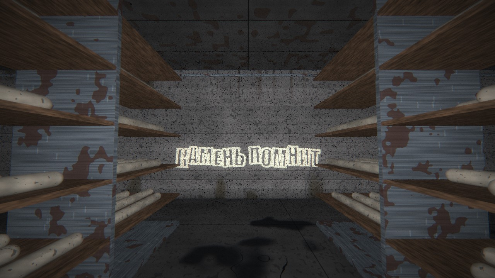

## Особенности

- **Вы видите только то, что сняли.** Экран чёрный, пока по нему не пройдёт лазер. Стены, лица и надписи проступают из миллионов точек и постепенно гаснут.
- **Здесь нельзя погибнуть, и от этого не легче.** В игре нет монстра, которого можно увидеть и понять. За спиной шаги, которые делают лишний шаг, когда вы встаёте. Стук из стен, шёпот, прибор, который отказывает в самый тёмный момент. Манекены, которые подходят, только пока вы на них не смотрите.
- **Скримеры.** Редкие и без предупреждения. Их можно отключить.
- **14 разных локаций.** От подъезда панельной девятиэтажки до скважины на глубине 3300 метров.
- **Полная озвучка.** Около 19 минут речи: диалоги, вступления и все 25 записок. Записка продолжает звучать, пока вы идёте дальше.
- **Детальные поверхности.** Облезлая краска, кафель, паркет, кирпич, лёд и порода считаются прямо в точке попадания луча. Лазер снимает не только цвет, но и рельеф.
- **Две концовки.** Решение одно, и принимать его придётся в самом низу.
- **Клавиатура с мышью и геймпад.** Плюс 34 настройки: изображение, звук, управление и всё, что пугает.

## Локации

| № | Локация | Что там |
|---|---|---|
| 1 | **Подъезд** | Девятый этаж, телефон без линии и лестница, которая кончается не там |
| 2 | **Подвал** | Кладовки, котельная и теплотрасса, где за вами идут шаг в шаг |
| 3 | **Школа № 3** | Штаб эвакуации, детские пальто на крючках, лишний человек на перекличке |
| 4 | **Горбольница** | Палаты с повязками на глаза и морг, где на столах на одно тело больше |
| 5 | **Музей** | Мамонт, манекены, галерея одинаковых лиц и запасник |
| 6 | **ДК «Горняк»** | Зрительный зал, полный людей, которые не двигаются |
| 7 | **Заря-Товарная** | Ночная станция и ряды брошенных вагонов |
| 8 | **Копёр** | Надшахтное здание, табельная доска и подъёмная машина |
| 9 | **Приёмный двор, −400 м** | Штреки и первый спуск |
| 10 | **Жилой блок, −900 м** | Застеленные постели и столовая на тринадцать голов |
| 11 | **Машинный зал, −1700 м** | Затопленные галереи и перерубленный кабель |
| 12 | **Кернохранилище, −2400 м** | Лабиринт из сорока лет бурения |
| 13 | **Ледяная галерея, −2900 м** | Лёд там, где его быть не может |
| 14 | **Скважина, −3300 м** | Конец съёмки |

## Как установить

1. Скачайте **[OtklikSetup.exe](https://github.com/Anonymouslol411/otklik/releases/latest/download/OtklikSetup.exe)**. Это маленький загрузчик, 49 КБ.
2. Запустите его, выберите папку и нажмите **«Скачать»**. Игра весит около 6 МБ, закачка продолжается с того же места после обрыва связи.
3. Нажмите **«Играть»**.

Можно обойтись без загрузчика: скачайте [Otklik.exe](https://github.com/Anonymouslol411/otklik/releases/latest/download/Otklik.exe) и запустите. Установка не нужна.

> [!NOTE]
> Файлы не подписаны платным сертификатом, поэтому Windows может показать предупреждение SmartScreen. Нажмите **«Подробнее»**, затем **«Выполнить в любом случае»**.

### Что нужно

- Windows 10 или 11, 64 бита
- Видеокарта с поддержкой WebGL2
- Microsoft Edge WebView2 Runtime. В Windows 11 он уже есть, для Windows 10 его можно скачать [у Microsoft](https://developer.microsoft.com/microsoft-edge/webview2/)
- Лучше всего наушники: звук в игре объёмный

## Управление

| Действие | Клавиатура и мышь | Геймпад |
|---|---|---|
| Идти | WASD | Левый стик |
| Смотреть | Мышь | Правый стик |
| Сканер, веер лазера | ЛКМ или F | RT |
| Обзорная развёртка | ПКМ | LT |
| Ширина луча | Колесо, Z / X | LB / RB |
| Действие | E | A |
| Прибор / ракетница | Q | Крестовина вверх |
| Бег | Shift | L3 |
| Присесть | C | B |
| Карта съёмки | Tab или M | Y |
| Пауза | Esc | Start |
| Полный экран | F11 | |

## Предупреждение

> [!WARNING]
> Игра для взрослых, 18+. В ней есть кровь, расчленённые тела, резкие громкие скримеры, мерцание и помехи на экране. Если у вас светочувствительность или вы плохо переносите такое, в настройках можно отключить вспышки, скримеры, кровь и останки.

## Как это сделано

Игра написана без движка: чистый WebGL2 и JavaScript, собранные в один exe.

- Мир хранится сеткой ячеек с геометрическими примитивами. Каждый импульс лазера это настоящий луч, и точка появляется там, куда он попал.
- Фактуры нигде не лежат: материал считается процедурно в точке попадания.
- Весь звук, кроме голосов, синтезируется на лету через Web Audio, с объёмным позиционированием.
- Модели прибора и ракетницы сделаны в Blender.
- Голоса записаны нейросетевым синтезом: Piper и Silero.

## Статус

Бета-версия. Игру пока мало проходили живьём, поэтому возможны шероховатости в сложности и частоте страшных событий, а синтезатор речи местами ставит неверные ударения. Если нашли ошибку, напишите в [Issues](https://github.com/Anonymouslol411/otklik/issues).

---

Голоса Silero можно использовать только некоммерчески, поэтому игра распространяется бесплатно.

